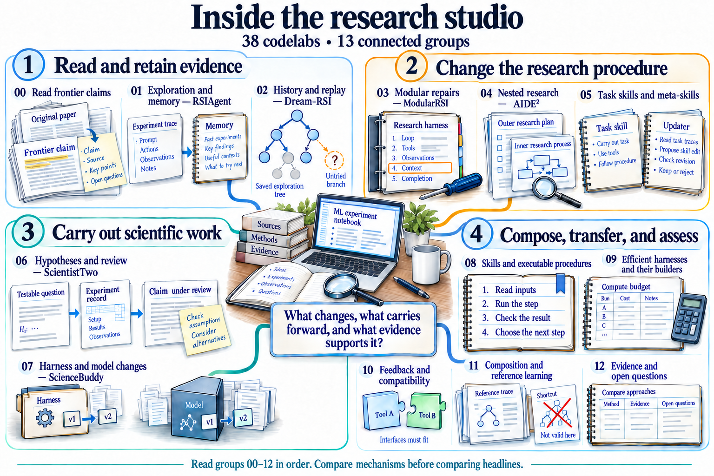
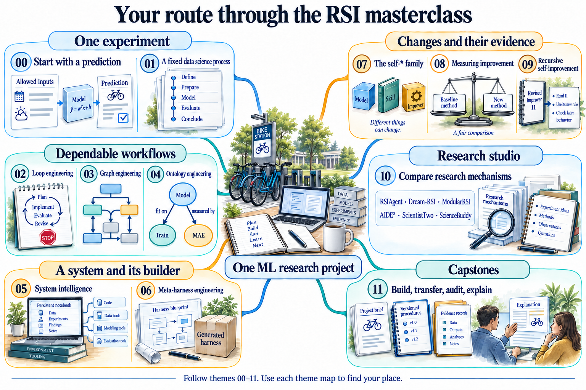

# Read and Rebuild October 2026 RSI Research

[Course](../README.md)

**You are here:** Theme 10 of 00–11 · Research Studio · 6 groups (October 2026 focus) · [Your place in the guided map](../COURSE-MAP.md#theme-10)

Study the mechanism before the headline. Each studio lab maps a recent October 2026 RSI paper to a small executable activity or an explicit result audit.

Complete the foundation themes first. Laptop adaptations preserve an idea, not the scale or headline result of the original system.

*Read group numbers 00–05 in order. Each group focuses on October 2026 RSI mechanisms. These miniature scenes are abridged explanations, not execution traces or paper results. The laptop demos use synthetic data and simplified implementations; they do not reproduce the full scale of the original benchmarks. Follow the group links for the source, adaptation, and focused figure.*

[Open the illustration at full size](../assets/illustrations/research-studio-map-v3.png).

Find theme 10 in the whole-course mindmap

*Follow theme numbers 00–11. The branches group concepts; they are not execution dependencies or a universal maturity ladder. The research names are selected examples. Use the theme number on each lesson to locate it here. This map describes the planned route, not completed experiments.*

[Open the illustration at full size](../assets/illustrations/course-mindmap-v2.png).

The 6 studio groups form the October 2026 research focus. Follow them in this order; each group explains its starting evidence and what you will carry forward.

| Group | October 2026 Paper Focus | Labs |
|-------|-------------------------|------|
| [Read a frontier claim](00_reading_frontier_research/README.md) | Which claim does the available evidence support? | 10.01–10.02 |
| [Budget RSI: Scoring Before Running](01_budget_rsi_scoring/README.md) | Can we score code edits before full evaluation? | 10.03–10.05 |
| [Second-Order RSI: Diagnostic Inquiry](02_second_order_diagnostics/README.md) | Why do failures occur before patching? | 10.06–10.08 |
| [Scaling RSI: Coordination & Swarms](03_scaling_coordination/README.md) | How do multiple agents coordinate for RSI? | 10.09–10.11 |
| [Adaptive Workflows: RSIFlow & Self-HPO](04_adaptive_workflows/README.md) | Can workflows adapt to evolving bottlenecks? | 10.12–10.14 |
| [Environments & Metrics: RSIGym & More](05_environments_metrics/README.md) | What environments support RSI research? | 10.15–10.17 |

The [complete course map](../COURSE-MAP.md) also lists every individual lab.

Start with the first lab and follow its next link. Each lab keeps its notes in a separate workspace and links any earlier experiment it reuses. The agent writes code; you predict, inspect, and explain. [Skill entry point](../skills/rsi-tutor/SKILL.md).

**Ready to continue when:** Compare October 2026 RSI systems by their changed object, feedback, inheritance, evaluation, and cost. Distinguish a source claim from your laptop adaptation and its observed result.

Use the capstones to transfer the ideas to a new task and defend your conclusions with evidence.

---

## October 2026 Papers Covered

### Full Laptop Demos (2 papers)

1. **Budget RSI** (arXiv:2610.29121) - Scoring code edits before execution
   - Full demo in `../12_october_2026_papers/01_budget_rsi/demo.py`
   - Runtime: < 5 minutes
   - Labs: 10.03–10.05

2. **SO-RSI** (arXiv:2610.05701) - Second-order diagnostic inquiry
   - Full demo in `../12_october_2026_papers/02_second_order_rsi/demo.py`
   - Runtime: < 2 minutes
   - Labs: 10.06–10.08

### Mechanism Analysis (7 papers)

3. **AReaL-RSI** (arXiv:2610.18083) - Adaptive scaling and coordination
4. **RSIFlow** (arXiv:2610.21791) - Adaptive self-improvement workflows
5. **RSIGym** (arXiv:2610.10310) - Flexible EaaS environment
6. **Self-HPO** (arXiv:2610.22791) - Harness-policy optimization
7. **Terminal-RSI** (arXiv:2610.22192) - Terminal agent RSI
8. **R2Orch** (arXiv:2610.22740) - Agent orchestration via self-play
9. **SwarmRSI** (arXiv:2610.20431) - Scientific agent swarms

See [Paper Summaries](../12_october_2026_papers/PAPER_SUMMARIES.md) for detailed analysis of all 9 papers.
